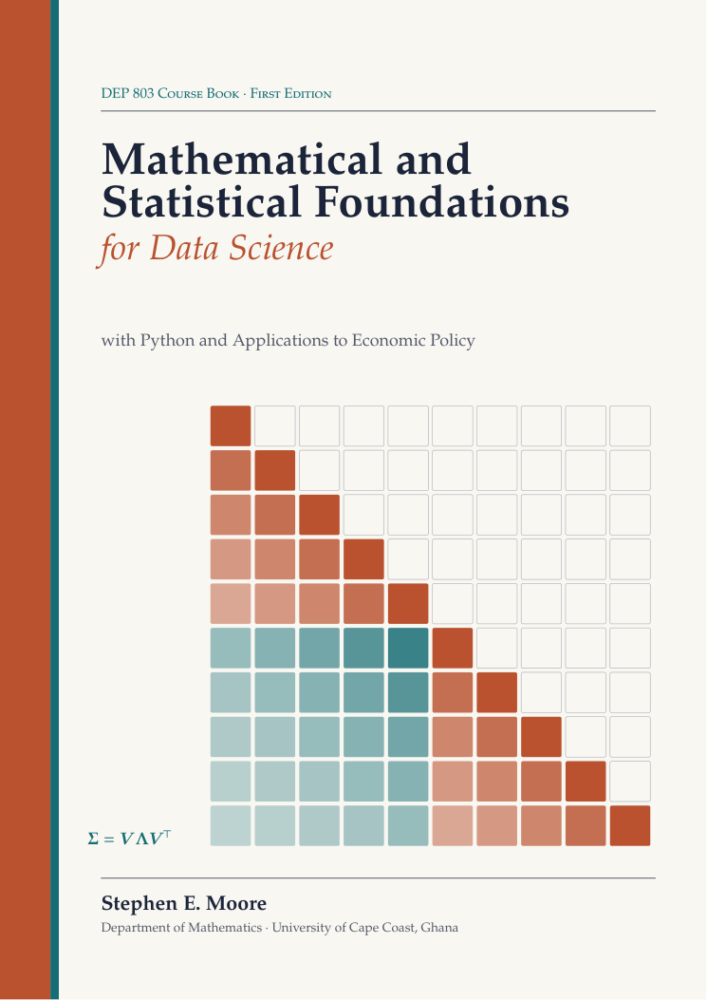

# Mathematical and Statistical Foundations for Data Science

### with Python and Applications to Economic Policy

[](LICENSE-BOOK.md)
[](LICENSE)



**DEP 803 Course Book, First Edition (2026)** · Stephen E. Moore · Department of Mathematics,
University of Cape Coast, Ghana

🌐 **Author's website:** [https://moorestephen.info/](https://moorestephen.info/)
📘 **The book (PDF):** [Mathematical_and_Statistical_Foundations_for_Data_Science.pdf](Mathematical_and_Statistical_Foundations_for_Data_Science.pdf)

This repository contains the course book and **all of its Python programs, organised by chapter**.
The book accompanies **DEP 803: Mathematical and Statistical Foundations for Data Science**
(3 credits), a graduate course for MPhil and PhD students in Data Science and Economic Policy.

## About the book

The course provides the mathematical toolkit for data science and econometric modelling:
**linear algebra, probability, optimisation and statistical inference**. Its emphasis is on
translating formal results into computational practice for **estimation, prediction and
uncertainty quantification in policy analytics**.

A regression is an orthogonal projection; a principal component is an eigenvector; an estimator is
the solution of an optimisation problem; the shadow price of a public budget is a Lagrange
multiplier; and a standard error is a statement about a sampling distribution, which we can
approximate by limit theorems, by simulation or by resampling. The book develops these ideas
rigorously (definitions, theorems and proofs), implements every one of them in Python, and
interprets them for policy questions: targeting social transfers, evaluating programmes,
measuring poverty and inequality, forecasting inflation, and allocating budgets.

**Course objectives.** On completing the course, students should be able to

1. derive and manipulate key results in linear algebra, probability and optimisation that
   underpin modern data-science methods;
2. implement numerical optimisation and simulation techniques to solve estimation and
   inference problems;
3. assess uncertainty using sampling distributions, asymptotics and resampling in
   policy-relevant contexts.

Every chapter contains:

- **Learning objectives**, a **chapter summary** and a guide to **further reading**
- definitions, theorems and proofs, with worked examples by hand and in Python
- highlighted **Key Concept** boxes: the ideas graduate students must master
- **Historical Notes** on the people and problems behind the mathematics
- **Policy Lens** boxes showing where the mathematics appears in economic-policy analysis
- **Caution** boxes on common mistakes and computational pitfalls
- **Graduate Perspective** boxes linking each topic to the research literature
- **exercises after every section**, tagged *Theory*, *Python*, *Policy* and *★ Graduate*,
  with answers and hints to selected exercises in Appendix B

Every Python listing in the book has been run, and the output printed beneath it is the real
output of the program in this repository.

## Contents and code

| Part | Chapter | Code folder | Topics and programs |
|---|---|---|---|
| I. Linear algebra for modelling | 1. Mathematical Notation, Vectors, Matrices and Computational Precision | [`code/ch01`](code/ch01) | norms and inner products, a price index, Leontief input–output, centring and covariance, floating point, cancellation, log-sum-exp, Kahan summation, Welford's variance, vectorisation and sparse matrices |
| | 2. Linear Algebra for Modelling: Rank, Projections and Decompositions | [`code/ch02`](code/ch02) | rank and identification, the dummy-variable trap, projections and the hat matrix, Gram–Schmidt, the Frisch–Waugh–Lovell theorem and fixed effects, leverage, LU/Cholesky/QR, the pseudoinverse and minimum-norm solutions |
| | 3. Eigenvalues, the SVD, PCA and Conditioning | [`code/ch03`](code/ch03) | labour-market Markov chains, quadratic forms, power iteration, PageRank, SVD and low-rank approximation, PCA of macro indicators and an asset (wealth) index, condition numbers, VIFs |
| II. Probability and statistical models | 4. Probability Foundations, Random Variables and Transformations | [`code/ch04`](code/ch04) | Bayes' theorem and targeting errors, Monty Hall, naive Bayes, ECDFs, joint distributions and copulas, change of variables, order statistics, PRNGs, inverse-transform sampling, Box–Muller |
| | 5. Common Distributions in Data Science and Econometrics; Likelihood | [`code/ch05`](code/ch05) | Poisson limit (horse kicks), overdispersion, income distributions, Lorenz curves and Gini, t/chi-square/F, the multivariate normal, GLMs, likelihood surfaces, beta–binomial |
| | 6. Expectation, Covariance, Limit Theorems and Concentration | [`code/ch06`](code/ch06) | Jensen and risk aversion, Simpson's paradox, conditional expectation, the LLN and CLT by simulation, heavy tails, the delta method, Hoeffding bounds and survey sample sizes, high-dimensional geometry |
| | 7. Estimation Principles: Moments, Maximum Likelihood and Information Geometry | [`code/ch07`](code/ch07) | bias–variance of estimators, method of moments, GMM and IV, numerical MLE, Fisher information and standard errors, Wald/LR/score tests, KL divergence, natural gradient, Bayesian estimation |
| III. Optimisation | 8. Optimisation: Convexity, Gradients, Hessians, Newton and Stochastic Gradient Methods | [`code/ch08`](code/ch08) | gradient checking, gradient descent and conditioning, line search and momentum, Newton/IRLS for logistic regression, Gauss–Newton, BFGS, SGD and Adam |
| | 9. Constrained Optimisation and Lagrange Multipliers in Policy Problems | [`code/ch09`](code/ch09) | consumer demand, the envelope theorem, KKT conditions, duality, the least-cost diet LP, restricted least squares, lasso/ridge, SVM dual, budget allocation, social planner, poverty-gap targeting, Ramsey taxation |
| IV. Computation and uncertainty | 10. Numerical Integration and Monte Carlo Simulation | [`code/ch10`](code/ch10) | consumer surplus, Newton–Cotes and Gauss–Hermite quadrature, Monte Carlo error, variance reduction, quasi-Monte Carlo, acceptance–rejection, Metropolis–Hastings, Gibbs, HMC, simulation studies, microsimulation of a cash transfer |
| | 11. Resampling: the Bootstrap, Permutation Tests and Uncertainty Intervals | [`code/ch11`](code/ch11) | CI coverage, the bootstrap and its failures, percentile/BCa/bootstrap-t intervals, Gini CIs, wild and cluster bootstrap, block bootstrap, randomisation inference for an RCT, multiple testing, jackknife, conformal prediction |
| | 12. Matrix Calculus for Machine Learning, Regularisation and the Bias–Variance Trade-off | [`code/ch12`](code/ch12) | matrix derivatives checked numerically, logistic and softmax gradients, backpropagation in NumPy, bias–variance, double descent, ridge and lasso (coordinate descent), regularisation paths, cross-validation, forecasting with many predictors |
| V. Synthesis | 13. Problem Set Clinic and Applied Foundations Review | [`code/ch13`](code/ch13) | four case studies: returns to education, poverty targeting with logistic regression, macroeconomic forecasting with factors, budget allocation under uncertainty; worked review problems |
| Appendix | A. A Python Toolkit for the Course | [`code/appA`](code/appA) | NumPy, SciPy and scikit-learn essentials |

Each chapter folder has its own `README.md` listing every program, the book section it belongs
to and what it demonstrates. Each program `code/chNN/name.py` is **self-contained**, and the file
`code/chNN/name.out` next to it contains the output printed in the book, so you can check your
results against it.

**Data.** All data sets are either *simulated* for teaching purposes or bundled with
scikit-learn (no download needed). Simulated data are designed to resemble household surveys,
labour-force surveys and macroeconomic panels, but they are **not official statistics** of Ghana
or of any other country.

## Getting started

You need Python 3 (3.9 or later) with NumPy, SciPy, pandas, Matplotlib and scikit-learn.

- **Easiest:** install [Anaconda](https://www.anaconda.com/download), which includes everything.
- **No installation:** open [Google Colab](https://colab.research.google.com/), upload a `.py`
  file (or paste its contents into a cell) and run it.
- **With pip:**

```bash
git clone https://github.com/moorekwesi/math-stat-foundations-data-science.git
cd math-stat-foundations-data-science
pip install -r requirements.txt
```

Run a single program, for example the Frisch–Waugh–Lovell example of Chapter 2:

```bash
python code/ch02/fwl_panel.py
```

Programs that draw figures save them as PDF files in the folder you run them from.
To run **every** program in the book and regenerate all outputs and figures (in `figures/`):

```bash
python run_all.py          # all chapters
python run_all.py ch05     # only Chapter 5
```

Some programs print computing times; those numbers depend on your machine. Every other output
is deterministic, because every program uses a fixed random seed
(`rng = np.random.default_rng(803)`).

## How to learn from this repository

1. Read a section of the book with the corresponding program open.
2. Run the program and compare your output with the `.out` file.
3. **Change something:** the sample size, the seed, the distribution, the step size, the
   penalty. Predict what will happen first, then check.
4. Attempt the *Python* and *Policy* exercises at the end of each section; most of them start
   from one of these programs.

## Reading materials

- K. P. Murphy (2022). *Probabilistic Machine Learning: An Introduction*. MIT Press.
- K. Matsuura (2022). *Bayesian Statistical Modeling with Stan, R, and Python*. Springer.
- A. Géron (2022). *Hands-On Machine Learning with Scikit-Learn, Keras, and TensorFlow*, 3rd ed. O'Reilly.
- P. Goulet Coulombe, M. Leroux, D. Stevanovic and S. Surprenant (2022). How is machine learning
  useful for macroeconomic forecasting? *Journal of Applied Econometrics*, 37(5), 920–964.

The book's reference list contains about 350 further works, chosen chapter by chapter.

## Citing the book

> S. E. Moore (2026). *Mathematical and Statistical Foundations for Data Science, with Python and
> Applications to Economic Policy*. Course book for DEP 803, Department of Mathematics,
> University of Cape Coast, Ghana. https://moorestephen.info/

## Licence and permissions

You are free to use, share and adapt these materials, for teaching, learning or any other
purpose, as long as you give credit to the author.

- **The book** (`Mathematical_and_Statistical_Foundations_for_Data_Science.pdf`) is licensed
  under the [Creative Commons Attribution 4.0 International Licence (CC BY 4.0)](LICENSE-BOOK.md).
- **The Python programs** (`code/` and `run_all.py`) are licensed under the [MIT Licence](LICENSE).

The full permission statements are in [LICENSE-BOOK.md](LICENSE-BOOK.md) and [LICENSE](LICENSE)
and on the copyright page of the book.

## Author

**Stephen E. Moore**, Department of Mathematics, University of Cape Coast, Ghana
Website: [https://moorestephen.info/](https://moorestephen.info/)

Corrections and suggestions are welcome: please open an issue in this repository.
